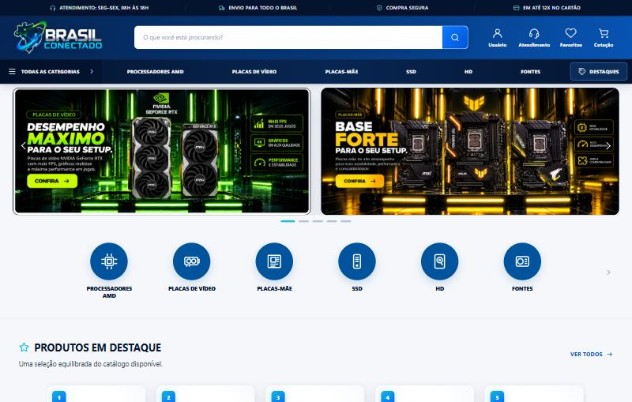
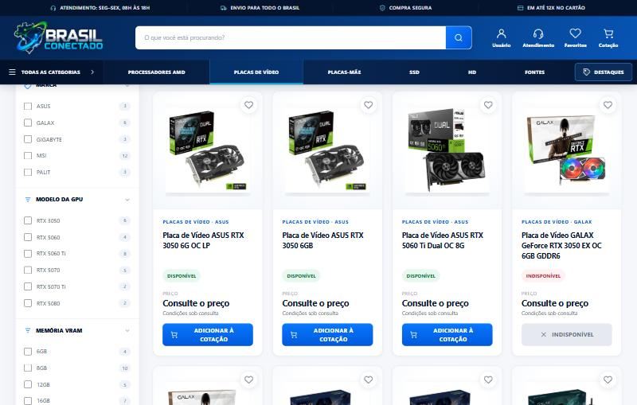
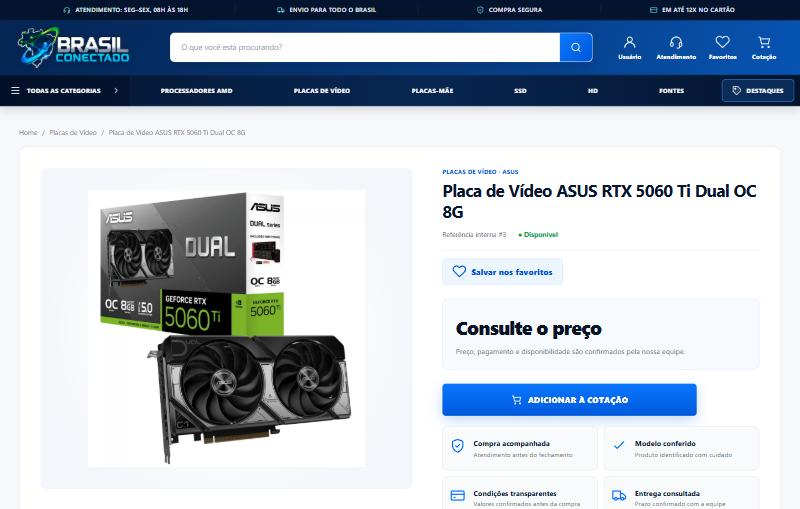

# Brasil Conectado – E-commerce de Hardware

🔗 Site no ar: https://brasilconectado.com.br/

Site de catálogo e vendas de hardware (placas-mãe, placas de vídeo, processadores, HDs), desenvolvido para a empresa onde trabalho.

> ⚠ O código-fonte é privado e pertence à empresa. Este repositório é apenas uma vitrine do projeto.

## Funcionalidades
- Catálogo de produtos por categoria
- Busca de produtos
- Lista de cotação e favoritos
- Área de conta do usuário
- Página administrativa para gerenciar imagens dos produtos
- Sitemap para SEO

## Tecnologias
PHP · HTML · CSS · JavaScript · Apache (.htaccess) · Hospedagem HostGator

## Minha participação
Desenvolvimento e publicação do site, com apoio de ferramentas de IA.

## Prints

